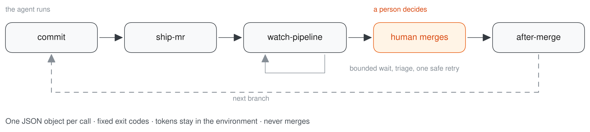

# SilkOps

Delivery skills for coding agents on GitLab and GitHub.

An agent can write the change. Getting it merged is still hand work: open the merge request,
wait for the pipeline, read the failing job, retry the flaky one, file the follow-ups, tidy up
after the merge. Left to itself an agent polls with `sleep`, improvises API calls in chat, prints
tokens into logs, and sometimes merges.

SilkOps gives the agent one command for each of those steps. Every command returns one JSON
object and a fixed exit code, so the agent acts on facts instead of guessing at output. It never
merges. A person does.



## Install

**Claude Code**

```
/plugin marketplace add OpenZephyr/SilkOps
/plugin install silkops@silkops
```

Then once, in a terminal, so the skills find the `silkops` command:

```
bash ~/.claude/plugins/cache/silkops/silkops/*/bin/silkops install-agent claude-code
```

**Codex, Cursor, OpenCode, Gemini CLI**

```
git clone https://github.com/OpenZephyr/SilkOps.git ~/.silkops
~/.silkops/bin/silkops install-agent all
```

Requires `jq`, `curl`, Python 3.9, and the host CLI: `glab` for GitLab or `gh` for GitHub.
Tokens are read from the environment only.

## Try it

```
silkops doctor
silkops watch --project group/project --mr 42
{"ok":true,"provider":"gitlab","status":"success","ready":true, …}
```

In a repository, tell the agent "adopt silkops". It checks the token, adds the conventions block,
and ships the first merge request.

## Skills

| Skill | What it does |
|---|---|
| `adopt` | Connect a repository: check the token, add the conventions block, ship the first MR |
| `commit` | Commit named paths in the repository's own message style |
| `ship-mr` | Push the branch, open or update its merge request, hand off to the watch |
| `watch-pipeline` | Bounded wait, triage against known failure facts, one safe retry, a ready verdict |
| `after-merge` | After a person merged: prune, confirm linked issues closed, watch the default branch |
| `milestone-from-plan` | Turn a plan's units into a milestone with dependency-linked issues |
| `verify-findings` | Sub-agents try to refute each review finding at a pinned commit; only survivors are filed |
| `file-residuals` | File review findings as issues, deduplicated per finding |
| `verify-handoff` | File one issue per surface a session could not test |
| `trace-timing` | Rank where the time goes in a job |
| `registry-ops` | Zero-copy retag, digest compare, tag listing |
| `consumer-onboarding` | Connect a project to an image factory, one confirmation per settings write |

## Guarantees

- Never merges, never pushes a protected branch, never edits a closed issue.
- Tokens never appear in arguments, URLs, or output.
- Every write names its target project explicitly.
- `SILKOPS_MARKER=off` makes every write anonymous, for repositories you do not own.

Pipelines and workflow runs are in scope. Clusters and anything behind `kubectl` are not.

## Documentation

- [Hosts and what each concept maps to](docs/providers.md)
- [Failure facts and their three layers](docs/facts.md)
- [Tests, mirror, and releases](CONTRIBUTING.md)
- [Diagrams](docs/diagrams/README.md)

MIT licensed. Issues and pull requests are welcome.
