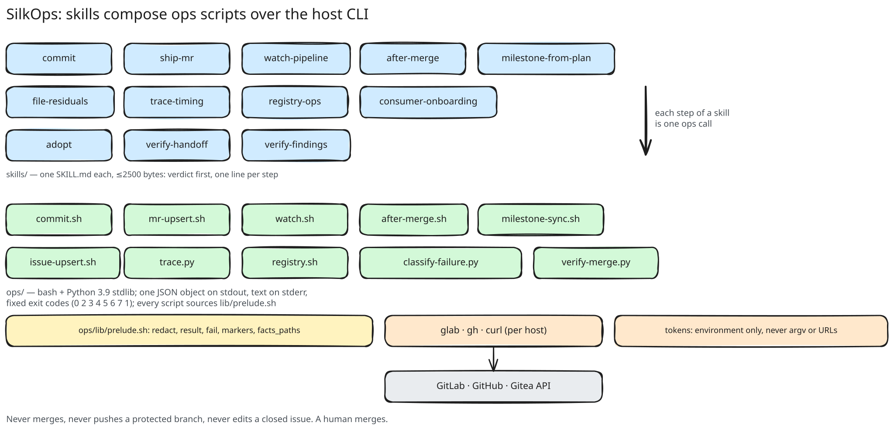
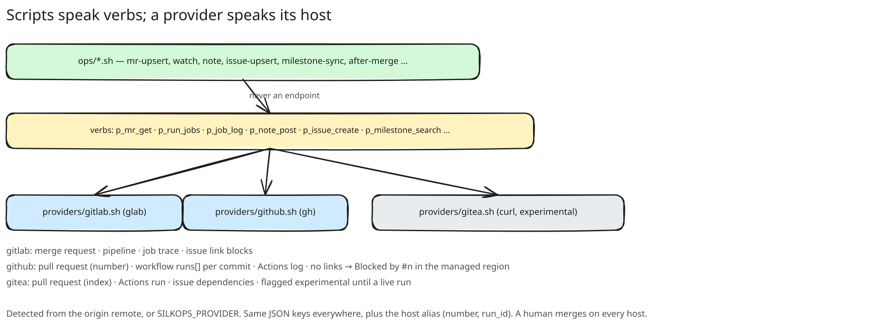

# Diagrams

Each diagram is an Excalidraw scene: the `.excalidraw` file is the source and the
`.excalidraw.svg` beside it embeds the scene, so both are editable. Open either in the Excalidraw
PWA, `docker run -p 5000:80 excalidraw/excalidraw`, or the VS Code extension, and export as SVG
with "Embed scene" on.

| scene | shows |
|---|---|
| `ship-watch-loop` | the delivery loop: commit, ship, watch, a person merges, after-merge |
| `architecture` | skills over ops over the host CLI |
| `fact-layers` | the three fact layers and their precedence |
| `providers` | scripts speak verbs; a provider speaks its host |

