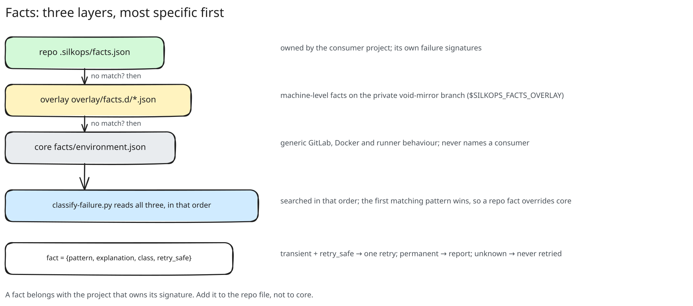

# Facts

A failure signature is a fact: what to match, what it means, whether a retry is safe. The watch
hands a failed job's trace, name and host `failure_reason` to `ops/classify-failure.py`, which
walks the facts and reports the first match, the class (`transient`, `permanent`, `flaky`), the
retry verdict and a hint.

## Three layers, most specific first

1. The consumer repo's `.silkops/facts.json`.
2. The plugin overlay: `overlay/facts.d/*.json`, or the path in `$SILKOPS_FACTS_OVERLAY`.
3. Core: `facts/environment.json`, generic GitLab, Docker and runner behaviour.

A fact belongs with the project that owns its signature; core never names a consumer. The
first matching fact wins, so a repo can override a core fact by repeating its signature.

## Fields

| key | use |
|---|---|
| `id` | stable name, used in triage notes and issues |
| `failure_reason` | regex on the host's job failure reason, checked before the trace |
| `pattern` | regex on the trace; with `failure_reason`, both must match |
| `jobs` | regex on the job name; the fact applies only to matching jobs |
| `class`, `retry_safe` | the verdict the watch acts on |
| `explanation`, `hint` | the text that goes in the triage note |
| `retired` | `true` skips the fact but keeps its history |

The exact schema is `facts/README.md`; `tests/ops/test_facts.py` validates every shipped fact.
